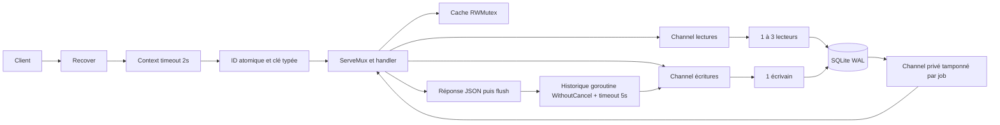

# Architecture du TP1

## Chemin d'une requête

`main.go` configure le processus et son arrêt; `database/` possède la base,
le pool et les transactions; `handlers/` valide, applique les mouvements et
construit les réponses; `models/` définit le contrat; `utils/` normalise les
cartes et les paramètres; `static/` embarque les SVG. `cmd/demo/` est un client
exécutable indépendant. Aucune dépendance hors du pilote SQLite.

## Schéma

Le SQL exact est dans `database/pool.go`, exécuté au démarrage avec
`CREATE ... IF NOT EXISTS` (schéma initial, aucune migration d'un autre projet).

| Table | Colonnes et contraintes | Fonction |
|---|---|---|
| `decks` | `id TEXT PRIMARY KEY`, `deck_count` 1–20, `shuffled` | Métadonnées et catalogue du cache |
| `cards` | PK `(deck_id,id)`, `code`, `location`, `pile`, `position` | Une ligne par carte physique |
| `piles` | PK `(deck_id,name)` | Existence des piles, même vides |
| `historique` | `id INTEGER PRIMARY KEY`, `horodatage`, `request_id`, `operation`, `deck_id` | Journal asynchrone |

`deck_id` est une clé étrangère vers `decks` dans les trois tables enfants.
`location` vaut `deck`, `drawn` ou `pile`; un CHECK impose un nom de pile
uniquement pour la dernière valeur. La carte n'est ni supprimée ni recréée lors
d'un déplacement. Dans deux paquets, deux AS ont des `id` distincts. L'identité
physique et l'emplacement unique garantissent la conservation.

L'index `cards_location(deck_id,location,pile,position,id)` permet de retrouver
les emplacements ordonnés; la PK permet les mises à jour ciblées. Le dépôt
charge actuellement le snapshot entier d'un deck (au maximum 1080 cartes), en
ordre d'identité, et trie les indices de l'emplacement demandé en Go. C'est un
compromis de simplicité : un seul modèle de mouvement pour toutes les routes,
mais un coût de lecture proportionnel à la taille du deck. Le snapshot est
strictement local au job. Seules les cartes modifiées sont écrites, avec une
instruction préparée réutilisée dans la transaction. L'index
`historique_deck(deck_id,id)` permet l'examen du journal par deck.

## Transactions et parallélisme

Chaque mutation est **un seul job d'écriture et une seule transaction** :
`BeginTx(ctx)` -> lecture/validation -> mouvement -> mises à jour -> `Commit`.
`defer Rollback` couvre tous les échecs et paniques. La création+pige est la
même transaction : une pige impossible ne laisse aucun deck partiel.
`piles/list` utilise le channel de lecture et une transaction de lecture,
afin que ses décomptes et cartes correspondent au même snapshot SQLite.
Tous les accès SQL opérationnels utilisent les méthodes `...Context` et des
paramètres `?`; seul le bootstrap PRAGMA/schéma est synchrone au démarrage.

SQLite WAL autorise plusieurs lecteurs et une écriture en parallèle. Deux
écrivains n'amélioreraient pas le débit : ils se disputeraient le verrou SQLite.
Le pool démarre donc exactement un écrivain et 1–3 lecteurs interchangeables,
avec `readers+1` connexions SQL conservées. `foreign_keys`, `busy_timeout=5000`
et `synchronous=NORMAL` sont configurés dans le DSN, donc pour chaque connexion.
WAL est activé explicitement au démarrage. NORMAL privilégie le débit; un arrêt
brutal de la machine peut perdre les transactions les plus récentes, contrairement
à un arrêt propre. Ne pas lancer plusieurs serveurs sur le même fichier.

Chaque channel de jobs a une capacité de 256. En saturation, la soumission
attend avec `select` sur l'annulation et l'arrêt; il n'y a pas de boucle active.
Chaque job possède un **channel de réponse unique de capacité 1**. Une réponse
ne peut donc être prise par un autre handler et le worker reste libre si le
client est déjà parti. Un worker vérifie `ctx.Err()` avant de commencer.
Le handler choisit entre réponse et `ctx.Done()` : 503 `Request timeout`.
Une expiration ne promet pas d'annuler une transaction déjà commise; ne pas
réessayer aveuglément une pige après une perte de réponse.

Pas de verrou global autour des opérations : les lectures SQL peuvent avancer
en parallèle. L'écrivain ne fait aucun accès réseau ni attente d'historique.
Les calculs de listes et de positions sont bornés; les écritures ne concernent
que les lignes changées. Le benchmark mesure le coût complet des handlers,
SQLite, encodage, validations et historique, pas une simple opération en mémoire.
Le débit n'est pas une garantie de capacité pour des millions d'utilisateurs.

## Cache et synchronisation

Le catalogue `deck_id -> deck_count` est chargé via un job lecteur avant
l'admission HTTP. Son `sync.RWMutex` autorise toutes les consultations simultanées,
avec un verrou exclusif très court à chaque création. Un mutex simple
sérialiserait inutilement les nombreuses lectures. Les handlers rejettent ainsi
un deck inconnu ou une pile sur un multideck sans requête SQL.

La publication du cache se fait **dans le job écrivain, après Commit et avant
la réponse du job**. Elle a lieu même si le client a cessé d'attendre. Avant
Commit, aucun deck inexistant n'est visible. Les cartes ne sont jamais mises
en cache, ce qui évite une seconde source de vérité et le partage de slices.
Les commentaires du code indiquent les sections où une race serait possible.

Les ID de requête utilisent un préfixe de démarrage et un compteur `atomic.Uint64`
partagé par les instances API du processus. La clé de contexte est un type privé.
Le compteur garantit l'unicité pendant la vie du processus; le préfixe réduit
les collisions entre démarrages, sans promettre un identifiant distribué.
Les deck IDs utilisent 12 lettres/chiffres de `math/rand/v2` et sont contrôlés
contre la base dans la transaction avant insertion.

## Historique et arrêt

Après encodage de la réponse de mutation, `Flush` remet la réponse au serveur
HTTP; ensuite seulement est lancée la goroutine d'historique. Elle dérive
`context.WithoutCancel(r.Context())`, conserve l'ID, ajoute son timeout de 5s,
et soumet une transaction au même écrivain. Les erreurs sont journalisées,
sans réécrire la réponse HTTP. La goroutine et chaque job ont leur propre
protection contre une panique. Le middleware recover enveloppe timeout puis ID.

L'historique est best effort : un arrêt forcé ou une saturation
supérieure à 5s peut perdre une entrée; une réponse réussie ne certifie pas la
durabilité du journal. Ce comportement suit l'exigence d'écriture asynchrone.

Arrêt normal : `Server.Shutdown` termine les requêtes en cours -> `API.Close`
interdit de nouveaux historiques et attend son WaitGroup -> `WorkerPool.Close`
signale l'arrêt aux soumissions, ferme les channels et attend tous les workers
-> fermeture SQL. Le verrou de cycle de vie évite `WaitGroup.Add` concurrent
avec un `Wait` partant de zéro. Le verrou `gate` du pool exclut les envois des
fermetures de channel, sans rester tenu pendant l'exécution SQL. `sync.Once`
rend la fermeture idempotente, y compris entre appels concurrents.
